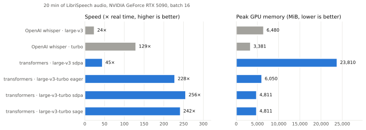
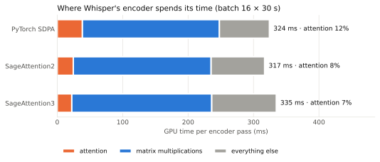
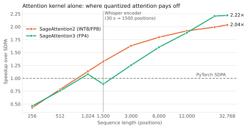
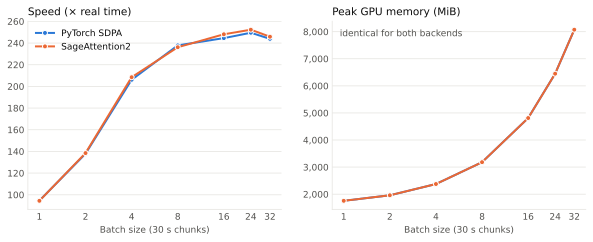

# whisper-inference-bench

I wanted to know what makes Whisper fast on a single GPU, so I measured it on an RTX 5090.
The comparison is OpenAI's reference implementation against the usual transformers recipe
(large-v3-turbo, fp16, chunked batching, efficient attention). I also wired SageAttention 2 and 3 into
transformers as attention backends to see how much they add.

The repo also has a small HTTP speech-to-text server and a CLI that use the same setup.

## Results at a glance

- **On long audio the recipe is about 2× faster than OpenAI's reference.** 20 minutes of speech take
  4.7 s instead of 9.3 s with the same turbo model, and accuracy doesn't change. The speed comes from
  batching, and batching costs memory: 4.8 GB at batch 16 against 3.4 GB for the reference. With batch 1
  the recipe uses 1.8 GB but is slower than the reference.
- **A single short phrase takes about 60 ms with both.** OpenAI's reference is a bit faster for this
  case (56 ms vs 63 ms).
- **SageAttention doesn't make Whisper noticeably faster.** SageAttention2 computes the attention
  1.33× faster. Attention is 12% of the encoder's GPU time and matrix multiplications are about 65%, so
  end to end the difference is smaller than the variation between runs (around ±10%). Accuracy stays
  the same.
- **SageAttention3 (FP4, Blackwell only) is slower here.** At Whisper's 1,500 positions, quantizing to
  FP4 takes more time than the faster kernel saves. Quantized attention starts to pay off
  with longer sequences: around 1,000 positions for SageAttention2 and 3,000 for SageAttention3. At 32k
  positions, which is the kind of length video and long-context models use, both reach 2 to 2.2×.

<picture>
  <source media="(prefers-color-scheme: dark)" srcset="docs/img/recipe-dark.svg">
  
</picture>

## Where the time goes

Most of Whisper's compute is in the encoder: 32 layers over 1,500 audio positions. This is the GPU time
of one batch of 16 windows of 30 s, split by type of operation:

<picture>
  <source media="(prefers-color-scheme: dark)" srcset="docs/img/profile-dark.svg">
  
</picture>

With SageAttention2 the attention kernel goes from 38 ms to 18 ms (25 ms counting its quantization
kernels), and the whole pass goes from 324 ms to 317 ms. SageAttention3's kernel takes 14 ms; centring K,
padding the sequence and quantizing to FP4 add the rest, and the pass ends at 335 ms.

<picture>
  <source media="(prefers-color-scheme: dark)" srcset="docs/img/kernels-dark.svg">
  
</picture>

These are timings of the attention kernel alone, with Whisper's shape (20 heads of size 64). I kept
batch × length at roughly 24k tokens so every point does a similar amount of work.

## Batch size

<picture>
  <source media="(prefers-color-scheme: dark)" srcset="docs/img/sweep-dark.svg">
  
</picture>

On this GPU the speed stops improving around batch 16 to 24, while memory keeps going up. Batch 8
already gets about 95% of the top speed and uses less than 40% of the memory of batch 32.

## Numbers

Speed and memory: 20 minutes of LibriSpeech test-clean, transcribed long-form in 30 s chunks.
WER: 500 test-clean utterances of up to 30 s, scored with Whisper's English normalizer.
Phrase latency: median over 30 single utterances of 4 to 8 s.
Setup: RTX 5090 limited to 400 W, torch 2.8.0 with CUDA 12.8, transformers 4.56.1, batch 16.

| Setup | 20 min of audio | × real time | Peak GPU memory | Phrase latency | WER |
|---|---:|---:|---:|---:|---:|
| OpenAI whisper · large-v3 | 49.6 s | 24× | 6,480 MiB | 183 ms | 1.73% |
| OpenAI whisper · turbo | 9.3 s | 129× | 3,381 MiB | 56 ms | 1.15% |
| transformers · large-v3 · sdpa | 26.8 s | 45× | 23,810 MiB | 214 ms | 1.07% |
| transformers · large-v3-turbo · eager | 5.3 s | 228× | 6,050 MiB | 80 ms | 1.12% |
| transformers · large-v3-turbo · sdpa | 4.7 s | 256× | 4,811 MiB | 63 ms | 1.12% |
| transformers · large-v3-turbo · SageAttention2 | 5.0 s | 242× | 4,811 MiB | 68 ms | 1.11% |

For the turbo rows with sdpa and SageAttention2 I ran three separate processes and kept the median
(sdpa: 4.72, 4.55 and 4.73 s; SageAttention2: 5.40, 4.55 and 4.98 s).

I also ran the comparison with torch 2.14 and CUDA 13, with both SageAttention versions built from
source (`bench/results-cu130.json`):

| Attention | 20 min of audio | Encoder pass (16 × 30 s) | WER | Output vs SDPA (cosine) |
|---|---:|---:|---:|---:|
| PyTorch SDPA | 4.98 s | 346 ms | 1.12% | — |
| SageAttention2 (INT8 QK, FP8 PV) | 4.99 s | 338 ms | 1.11% | 0.9993 |
| SageAttention3 (FP4) | 5.01 s | 358 ms | 1.13% | 0.981 |

The raw results behind every chart and table are in `bench/results-*.json`.

## How SageAttention is plugged in

`whisper_sage.attention` registers SageAttention with transformers' `AttentionInterface`. Only models
loaded with `attn_implementation="sage"` or `"sage3"` use it; nothing global is patched.

```python
from whisper_sage import load_pipeline

pipe = load_pipeline(attn="sage")          # "sdpa" (default), "eager", "sage", "sage3"
pipe("phrase.wav", generate_kwargs={"language": "es"})
```

Some calls can't be served exactly by these kernels: an explicit attention mask, dropout, fp32, head
sizes they don't support, or very short queries like the one-token steps of decoding. Those go to PyTorch
SDPA, so the output stays correct.

Whisper scales the query itself and passes `scaling=1.0`. SageAttention3 has no scale argument, so the
backend multiplies the scale into the query before calling it.

`whisper_sage.attention.stats` counts how many calls each kernel handled and how many went to SDPA.

## Using it

```bash
uv sync                                   # torch (CUDA 12.8 wheels), transformers, …
uv pip install sageattention==2.2.0 --no-build-isolation   # optional, compiles CUDA kernels
uv run whisper-sage recording.wav --language es             # CLI
uv run --extra server whisper-sage-server --language es     # HTTP server on :5200
curl -F file=@phrase.wav http://localhost:5200/stt
```

For multichannel audio the server keeps a single channel (`channel`, 0 by default). On a ReSpeaker 4-Mic
Array, channel 0 is the processed one, with beamforming, echo cancellation and noise suppression.

SageAttention3 comes from a gated Hugging Face repository (`jt-zhang/SageAttention3`) and only runs on
Blackwell GPUs. To build either version against torch 2.14 I had to change `-std=c++17` to `-std=c++20`
in their `setup.py`, because torch's headers now need C++20. I built them with CUDA 13.4 and GCC 15.

## Reproducing

```bash
mkdir -p data && curl -L https://www.openslr.org/resources/12/test-clean.tar.gz | tar xz -C data
bench/run_all.sh            # recipe comparison, batch sweep, kernel sweep, encoder profile
python bench/benchmark.py --librispeech data/LibriSpeech/test-clean --impls sdpa,sage,sage3
python bench/plots.py       # regenerates docs/img/*.svg
```

`run_all.sh` uses two environments: `.venv` with torch 2.8, CUDA 12.8 and SageAttention 2.2, and
`.venv-cu130` with torch 2.14, CUDA 13 and SageAttention 2.2 and 3 built from source. Expect the numbers
to move a few percent from run to run; the repeated measurements above show roughly how much.

## License

MIT
